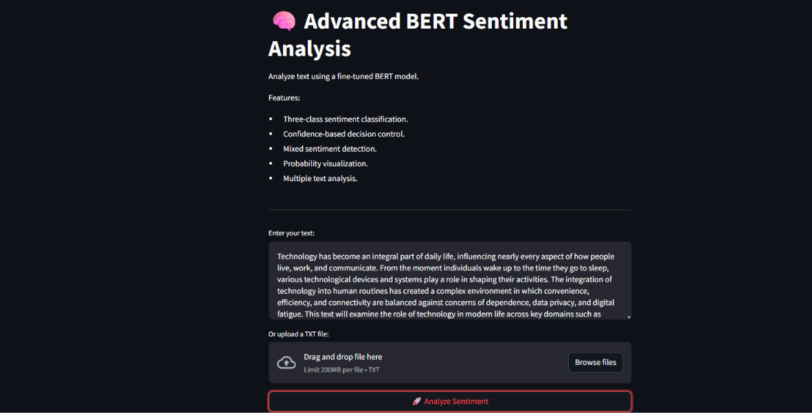
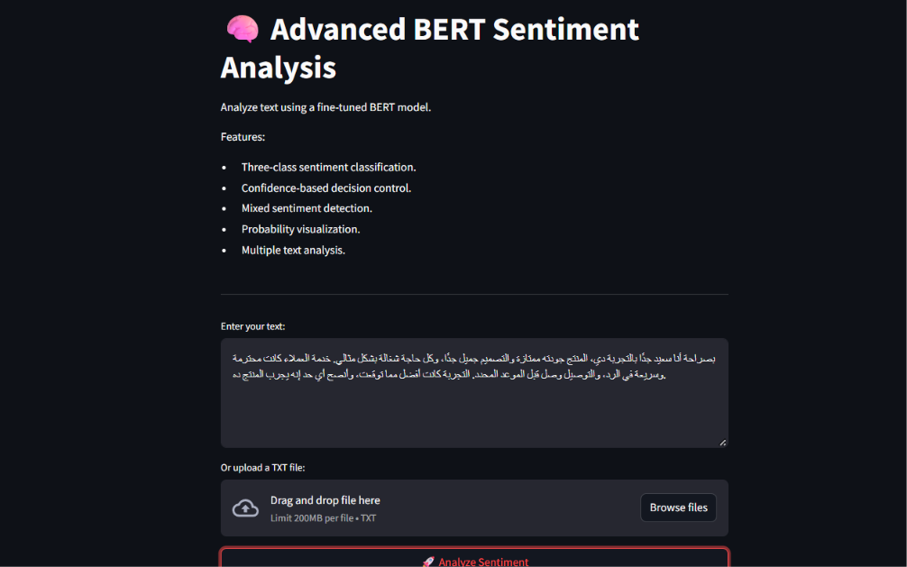
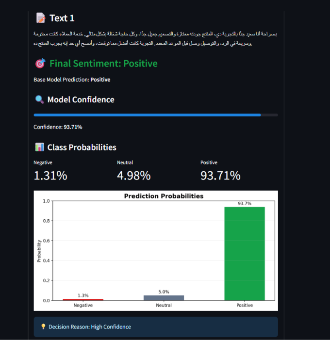
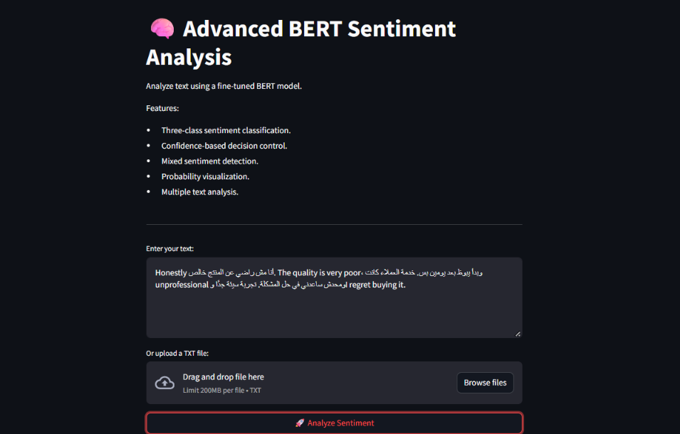
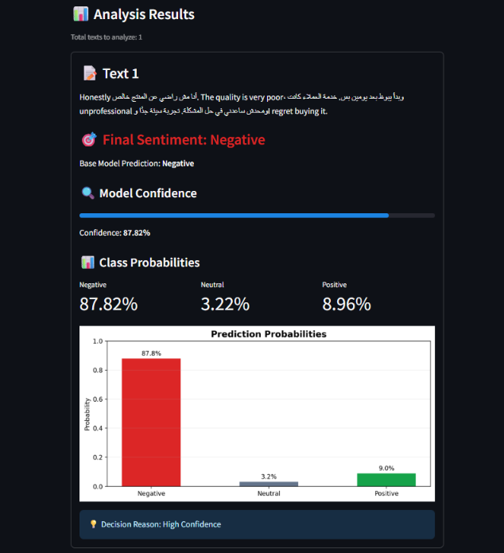
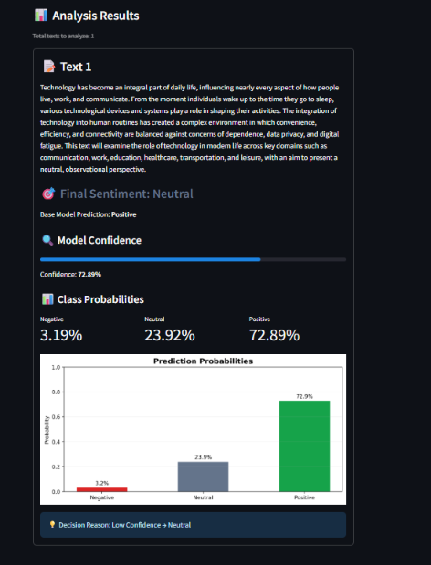

# Multilingual Sentiment Analysis (Arabic & English)

A Natural Language Processing (NLP) project that analyzes text in **Arabic and English** and classifies its sentiment as **Positive, Negative, or Neutral**. The project explores traditional machine-learning approaches, fine-tunes a multilingual transformer, and provides a Streamlit interface for interactive predictions.

## Demo

The Streamlit application accepts text directly or reads a `.txt` file. It displays the final sentiment, the model's original prediction, confidence, class probabilities, and a probability chart.



### Example predictions

| Arabic input | Mixed Arabic-English input | English / positive example |
|---|---|---|
|---|---|---|
|  |  |  |  |

Additional examples:



## Project structure

```text
.
├── app.py
├── ml-algorithms-sentiment-analysis.ipynb
├── multilingual-sentiment-analysis-using-xlm-roberta.ipynb
├── Text-test.txt
└── assets/
    ├── app-overview.png
    ├── arabic-sentiment.png
    ├── arabic-positive.png
    ├── mixed-language.png
    ├── mixed-language-negative.png
    └── positive-sentiment.png
```

## Approaches

### 1. Traditional machine-learning models

The first notebook, `ml-algorithms-sentiment-analysis.ipynb`, builds a three-class tweet sentiment classifier using text preprocessing and TF-IDF features. It trains and compares:

- Logistic Regression
- Decision Tree
- Random Forest
- Multinomial Naive Bayes

The reported test results are:

| Model | Test accuracy | Macro F1 |
|---|---:|---:|
| Logistic Regression | 78.42% | 78.13% |
| Decision Tree | 60.41% | 57.59% |
| Random Forest | **90.60%** | **90.51%** |
| Naive Bayes | 79.53% | 79.22% |

Random Forest achieved the strongest results among these four models in the notebook.

### 2. Multilingual XLM-RoBERTa

The second notebook, `multilingual-sentiment-analysis-using-xlm-roberta.ipynb`, fine-tunes **XLM-RoBERTa (`xlm-roberta-base`)** for Arabic and English sentiment classification.

The notebook workflow includes:

1. Loading Arabic and English sentiment datasets.
2. Cleaning text, removing duplicates, and preparing labels.
3. Combining the datasets and retaining language information.
4. Creating stratified train, validation, and test splits.
5. Tokenizing the entity and text as a pair.
6. Fine-tuning XLM-RoBERTa with class-weighted cross-entropy loss.
7. Evaluating the model overall and separately by language.
8. Reviewing incorrect predictions and visualizing training metrics.

**Reported evaluation results**

| Evaluation | Accuracy |
|---|---:|
| Validation | 93.29% |
| Test | **93.24%** |
| Arabic test subset | 93.53% |
| English test subset | 92.83% |

The overall test classification report also shows a weighted F1-score of approximately **0.93**.

**Dataset note:** The Arabic dataset in this notebook contains Negative and Positive examples only. It does not provide Arabic Neutral examples. Therefore, the three-class model's Arabic subset accuracy should not be interpreted as evidence of three-class Arabic coverage. The English subset includes all three sentiment classes.

## Streamlit application

`app.py` provides a user interface for running predictions with a locally saved Hugging Face sequence-classification model.

### Application features

- Three sentiment labels: Negative, Neutral, and Positive.
- Text input through the app or `.txt` file upload.
- Multiple-line text processing.
- Confidence score and class probabilities.
- Bar chart for the prediction probabilities.
- Confidence-based decision logic:
  - A Positive or Negative prediction below the configured confidence threshold is changed to Neutral.
  - A close balance between Positive and Negative probabilities can also produce a Neutral result.
- Explanation of the decision rule that was applied.

> **Important model setup:** The app currently loads a model from a local directory configured by `MODEL_PATH` in `app.py`. Update this path to the directory containing your compatible fine-tuned model and tokenizer. The notebook saves its XLM-RoBERTa model to `./final_xlmr_model`; make sure the application configuration and model architecture match the checkpoint you intend to use. The model weights are not included in this repository bundle.

## Installation

Python 3.9+ is recommended.

1. Clone the repository:

   ```bash
   git clone https://github.com/<your-username>/<your-repository>.git
   cd <your-repository>
   ```

2. Create and activate a virtual environment (recommended):

   ```bash
   python -m venv .venv
   ```

   Windows:

   ```bash
   .venv\Scripts\activate
   ```

   macOS / Linux:

   ```bash
   source .venv/bin/activate
   ```

3. Install the application dependencies:

   ```bash
   pip install streamlit torch transformers matplotlib
   ```

   For running the notebooks, install the additional packages used for data preparation, training, and evaluation:

   ```bash
   pip install jupyter pandas numpy scikit-learn datasets nltk seaborn matplotlib wordcloud
   ```

4. Set `MODEL_PATH` in `app.py` to your local model directory.

5. Run the application:

   ```bash
   streamlit run app.py
   ```

Streamlit will print a local URL (usually `http://localhost:8501`) in the terminal.

## Datasets

The multilingual notebook references these datasets:

- **Arabic:** [Arabic Sentiment Reviews](https://www.kaggle.com/datasets/abdallaellaithy/330k-arabic-sentiment-reviews)
- **English:** [Twitter Entity Sentiment Analysis](https://www.kaggle.com/datasets/jp797498e/twitter-entity-sentiment-analysis)

You may need to download the datasets and update the dataset paths in the notebook to match your environment. The notebook uses a subset of up to 80,000 rows from the Arabic dataset.

## Repository contents

- `app.py` — Streamlit prediction interface.
- `ml-algorithms-sentiment-analysis.ipynb` — TF-IDF and traditional ML experiments.
- `multilingual-sentiment-analysis-using-xlm-roberta.ipynb` — Arabic-English XLM-RoBERTa training and evaluation workflow.
- `Text-test.txt` — sample text for testing the interface.
- `assets/` — screenshots used in this README.

## Limitations and future improvements

- Add Neutral Arabic training examples and evaluate all three classes for Arabic.
- Make the model path configurable through an environment variable or command-line setting rather than a machine-specific absolute path.
- Include a reproducible dependency file and model download instructions.
- Evaluate on additional domains and independently collected test data.
- Add more robust handling for very long text and language-specific preprocessing.

## Acknowledgements

This project uses the Hugging Face Transformers ecosystem, PyTorch, scikit-learn, and Streamlit.

---

*Built as an educational NLP project exploring sentiment analysis across Arabic and English.*
